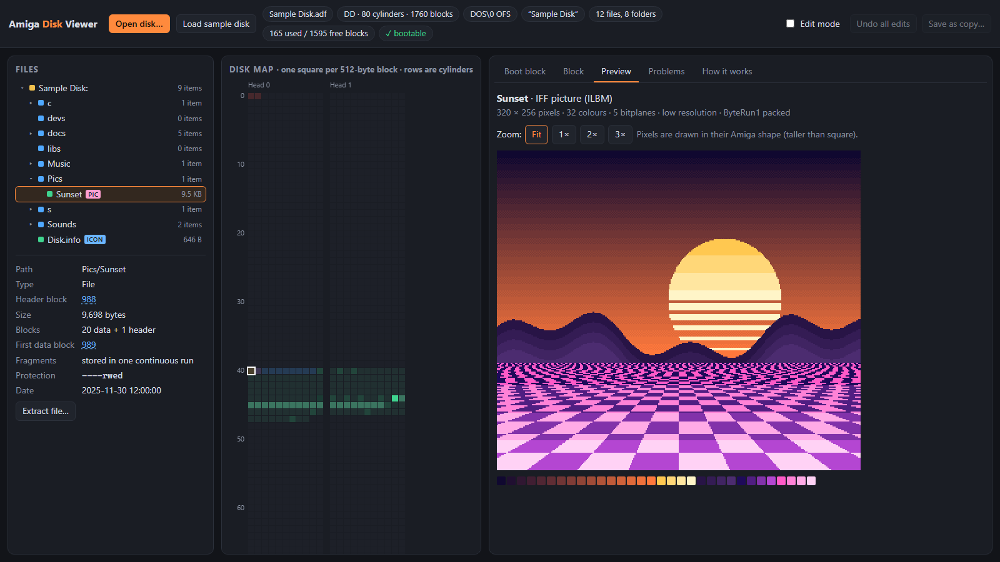
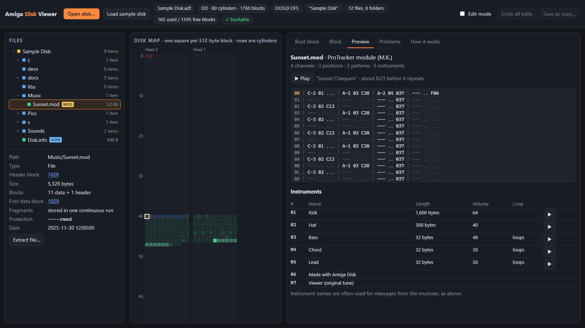
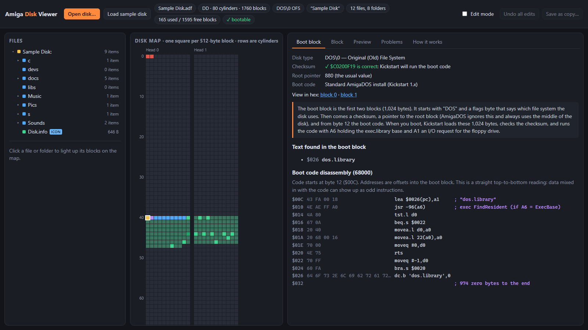
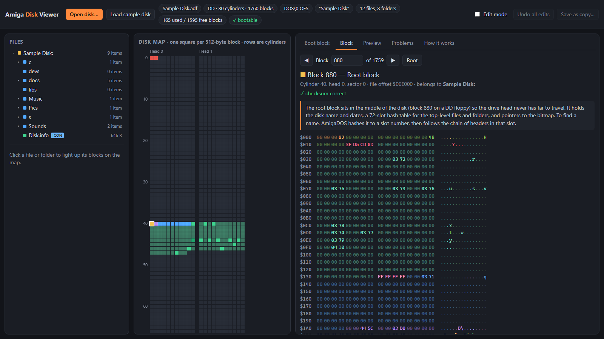

# Amiga Disk Viewer

**See inside Amiga floppy disk images (ADF/ADZ) in your browser:** a block-by-block disk map, a boot-block decoder with a 68000 disassembler, a labelled hex view, the file tree, and previews of the pictures, icons, sounds, music and AmigaGuide documents on the disk.

### [▶ Try it now](https://trustyferret.github.io/AmigaDiskViewer/?sample)

It opens with a built-in sample disk. Drop your own `.adf` or `.adz` on it to look at that instead. It all runs inside your browser: nothing is uploaded, nothing is installed, and your disk images are never changed.

- **Disk map:** every 512-byte block, coloured by what it holds (boot block, root, folders, file headers, data, bitmap, free). Click any square to look inside.
- **Boot block:** the DOS type and checksum, and a 68000 disassembly of the boot code, with system calls and trackloader fields named. Useful for game disks that skip AmigaDOS.
- **Hex view:** every field of every block labelled and colour-coded. Pointers can be clicked to follow them.
- **Preview:** IFF pictures (including HAM and Extra Half-Brite), Workbench icons, 8SVX sounds, ProTracker music with a live pattern view, text and AmigaGuide. PowerPacker files are unpacked first.
- **Problems:** broken checksums, loops, blocks used twice and bitmap disagreements, worded neutrally because game disks often break the rules on purpose.
- **Edit mode:** change bytes, fix checksums, and save the result as a copy.

| Music | Boot block | Hex view |
|---|---|---|
|  |  |  |

Tested against about 2,190 real disk images without a crash.

## Running it yourself

No install and no build. Download the repository (green **Code** button → **Download ZIP**), unzip it, and double-click `index.html`. It works offline.

## Opening a disk

1. Open the page (the [live version](https://trustyferret.github.io/AmigaDiskViewer/), or `index.html` from your copy).
2. Drag an `.adf` or `.adz` file onto the page, or click **Open disk…**.
   **Load sample disk** builds a small demo disk instead.

ADF is the standard image of an 880 KB DD floppy (HD 1.76 MB images work too, as do images with 81–84 cylinders). ADZ is a gzipped ADF; the page unpacks it itself.

## What you see

- **Top bar:** the disk size, its DOS type (OFS, FFS, international, directory cache, or "not an AmigaDOS disk"), its name, the number of files and folders, used and free space, and whether it is bootable.
- **Disk map:** one square for each 512-byte block. Each row is one cylinder: head 0 (the top side) on the left, head 1 on the right. The colour shows what the block is used for; hover over a legend entry for an explanation. Hover over a square to see its block number and owner, and click it to look inside.
- **Files:** the folder tree. Files the preview recognises have a coloured tag: **TXT**, **PIC**, **ICON**, **SFX**, **MOD** or **PP** (PowerPacker). Click a file to light up its blocks on the map and see its size, protection bits, date, comment, and how many pieces it is stored in. **Extract file…** saves a copy to your computer.
- **Boot block tab:** the DOS type, checksum, root pointer, any text in the boot block, and a 68000 disassembly of the boot code. `jsr -nn(a6)` calls are named (e.g. `DoIO`, `AllocMem`), and so are the trackdisk I/O request fields that trackloaders fill in.
- **Block tab:** a hex and ASCII view of one block. Each field is coloured; hover over a byte to see which field it belongs to. The table below lists every field. Click a pointer, or double-click it in the hex view, to follow it to its block. ◀ ▶ step through the disk.
- **Preview tab:** shows what is inside the selected file (see below). Clicking a recognised file switches to this tab by itself.
- **Problems tab:** everything that doesn't add up, such as wrong checksums, loops, blocks used twice, or bitmap disagreements. Game disks often break the rules on purpose (copy protection, data hidden from AmigaDOS), so a problem here does not always mean damage.
- **How it works tab:** a short explanation of the Amiga disk format.

## Previews

Files are recognised by what is inside them, not by their names, because game disks often use odd names.

- **Pictures (IFF ILBM, ACBM, PBM):** drawn with their own colours, including HAM (4,096 colours) and Extra Half-Brite, and with Amiga-shaped pixels (low-resolution pixels are slightly taller than wide). **Zoom** offers Fit, 1×, 2× and 3×. The palette is shown underneath. For an IFF animation, the first frame is shown.
- **Workbench icons (`.info`):** the normal and selected images, the icon type, default tool and tool types. An icon stores colour numbers, not colours, so you can switch between the **Workbench 1.x** palette (blue, white, black, orange) and the **2.0 and later** palette (grey, black, white, blue). It starts with the one the icon was made for.
- **Sounds (IFF 8SVX):** a waveform with **Play**. The looping part is shaded. Fibonacci-delta packed sounds are unpacked.
- **Music (ProTracker modules):** **Play** streams the song, and a tracker-style pattern view follows along. The instrument list has a ▶ button to hear each instrument on its own. Musicians often used instrument names for messages, so read them.
- **Text:** shown with Amiga style codes removed. **AmigaGuide** documents (the Amiga's hypertext help) show one page at a time, with working links and a page list.
- **PowerPacker (PP20) files** are unpacked first, then previewed. **Extract unpacked…** saves the unpacked file. Files packed with other packers (Rob Northen ProPack, Imploder, Crunch-Mania and others) are named but not unpacked.

## Editing

Tick **Edit mode** to change bytes:

1. In the Block tab, click a byte and type two hex digits. Arrow keys move, Esc stops.
2. Changed bytes turn orange. Blocks with changes get an orange corner on the map.
3. If a block's checksum is now wrong, a **Fix checksum** button appears (there is one for the boot block on the Boot block tab too).
4. **Save as copy…** downloads the edited disk as `<name>-edited.adf`. **Undo all edits** puts everything back.

Your original file is never changed. A web page cannot write to it anyway.

## For developers

- No build step and no dependencies. Everything in `src/` except `app.js` is plain JavaScript that runs both in the browser and in Node: `adf.js` (the disk format), `m68k.js` (the disassembler), `edit.js` (editing), `preview.js` (recognising and decoding files), `modplayer.js` (the ProTracker player), and `build-adf.js` / `build-files.js` (which write disks and files for the tests and the sample disk).
- `npm test` (or `node --test "tests/*.test.js"`) runs the tests. They build their own disks and files in memory, so no disk images are stored in the repository.
- `node tools/scan.js <folder>` reads every ADF/ADZ under a folder (read-only) and reports what the parser and the preview make of them. It's a good check after changing either.
- `index.html?sample` opens the sample disk directly. Add `&tab=block&block=880`, `&file=Pics/Sunset`, `&node=Pictures` (an AmigaGuide page), `&zoom=2` or `&edit=1` to choose what it shows; this is handy for screenshots.

## Licence

MIT. See [LICENSE](LICENSE).
